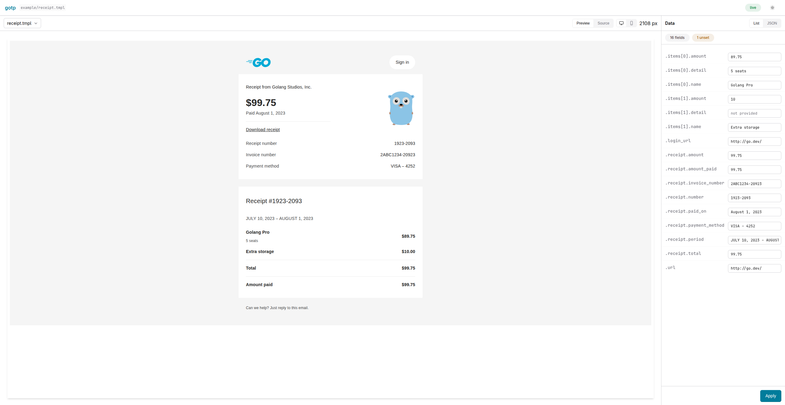

<a href="https://zerodha.tech"></a>

# Go Template Previewer

Simple utility to live edit Go template and preview with custom data.



## Installation

Download the latest release from the [releases page](https://github.com/vividvilla/gotp/releases), or clone this repository and run `make build`. The web UI is embedded in the binary, so the binary is all you need.

## Usage

```txt
Go template previewer - Live preview Go templates with custom data.

Usage:
gotp sample.tmpl
gotp --base-tmpl base.tmpl sample.tmpl
gotp --base-tmpl base.tmpl sample.tmpl --data '{"name": "Gopher"}'
gotp --base-tmpl base.tmpl sample.tmpl --data-file data.json
gotp --base-tmpl 'base/*.tmpl' sample.tmpl
gotp --text --stub-funcs mail.tmpl
cat sample.tmpl | gotp -
gotp --web sample.tmpl
gotp --web --addr :9000 sample.tmpl
gotp --web --base-tmpl base.tmpl sample.tmpl

  -a, --addr string             Address to start the server on. (default "127.0.0.1:1111")
  -b, --base-tmpl stringArray   Base template, or glob pattern.
  -d, --data string             Template data as JSON.
      --data-file string        File containing template data as JSON.
      --sprig                   Enable sprig functions
      --stub-funcs              Stub out undefined template functions instead of failing
      --text                    Render as plain text (no HTML escaping)
  -v, --version                 Version info
  -w, --web                     Run web UI
```

It can run in either `commandline` or `web` mode. Commandline mode renders the template on stdout and
web mode runs a web server which provides UI to update template data and live rendering when template changes.

```bash
# Renders sample.tmpl on stdout.
gotp sample.tmpl

# If your template uses base templates then you can specify it as a commandline flag.
gotp --base-tmpl base.tmpl sample.tmpl

# If your template uses Sprig template functions you can specify a flag.
gotp --sprig --base-tmpl base.tmpl sample.tmpl

# If there are multiple base templates then you can repeat the flag.
gotp --base-tmpl base-header.tmpl --base-tmpl base-footer.tmpl sample.tmpl

# You can also use glob pattern to specify multiple base templates.
gotp --base-tmpl "base-*.tmpl" sample.tmpl

# Specify the data required by templates as a JSON input. For example if your template
# has variable `{{ .name }}` then you can specify JSON data as `{ "name": "Gopher" }`.
gotp --base-tmpl base.tmpl sample.tmpl --data '{"name": "Gopher"}'

# Or read the same data from a file.
gotp --base-tmpl base.tmpl sample.tmpl --data-file data.json

# Templates that are not HTML (plain text mail, YAML, SQL) should be rendered with
# --text, so that values are not HTML-escaped.
gotp --text mail.tmpl --data '{"name": "Tom & Jerry"}'

# Read the template from stdin.
cat sample.tmpl | gotp -

# You can do all of the above commands with `--web` flag to start a web server which renders the output.
gotp --web --base-tmpl base.tmpl sample.tmpl --data '{"name": "Gopher"}'

# By default web server listens on `127.0.0.1:1111`, you can change it with `--addr`.
# Pass `--addr :1111` if you need it reachable from other machines.
gotp --web --addr :9000 --base-tmpl base.tmpl sample.tmpl
```

## Custom template functions

Templates that call functions your application registers cannot be parsed on their own, since
the function is not defined. `--stub-funcs` registers a placeholder for each of them so the
template still previews:

- if the template data has a key matching the function name, the stub returns that value, so
  `{{ nominee_name }}` can be mocked with `--data '{"nominee_name": "Gopher"}'`
- inside a pipeline the stub passes its input through, so `{{ .date | myformat }}` renders `.date`
- otherwise it renders a visible `«name»` placeholder

For the functions from [Sprig](http://masterminds.github.io/sprig/), use `--sprig` instead, which
registers the real implementations.

## Discovered fields

The web UI lists every field the template reads, including fields inside `if`, `range`, `with` and
base templates. Paths are shown scoped to where they are read, so a field inside
`{{ range .posts }}` reads as `.posts[].title`. **Copy as JSON data** fills the editor with a
skeleton of all of them, ready to fill in.

Fields reached through a variable (`{{ range $_, $post := .posts }}{{ $post.title }}`) are not
reported, and a scope that cannot be resolved statically is marked with a `*` segment.

## Development

```bash
make check   # go vet + go test -race
make build   # build ./gotp
```
